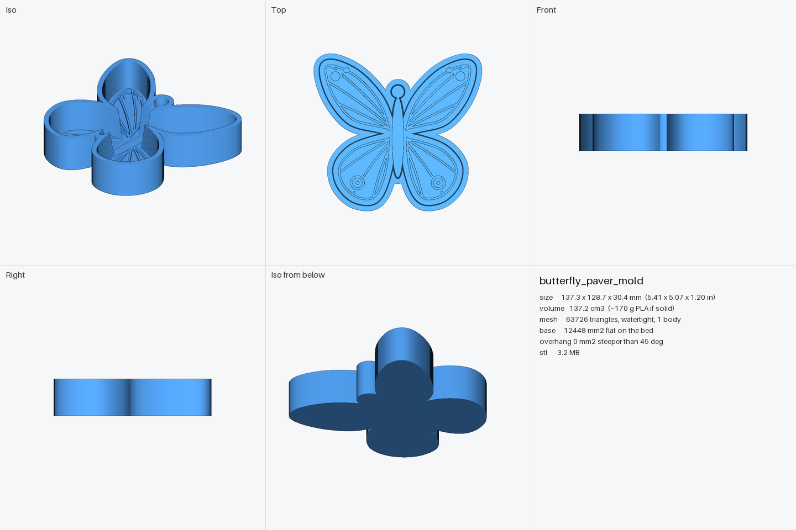

# 3D Workspace

Describe an object in plain words and get back a print-ready STL. Built for
[Claude Code](https://claude.com/claude-code): Claude writes each model as a short
Python script, builds it, checks it's printable, looks at the rendered previews, fixes
what's off, and hands you the STL. Nothing is modeled by hand. To tweak a result
yourself, import the STL into Tinkercad, a slicer, or any CAD app.

| | |
|---|---|
|  | Example: a 5 in cement paver mold with butterfly relief, built from the prompt *"a 5x5 inch cement paver mold in the shape of a 2D butterfly"*. |

## Quick start

Open Claude Code (terminal, desktop app, or IDE) in any folder and say:

> Set up this project: https://github.com/atsmith2k/3d-workspace

Claude clones it, installs everything, runs a self-test, and asks what you want to make.
Then just describe it:

> A wall hook for a 1/2 in dowel, holds 2 kg, screw holes for #8 screws
>
> A 5 in cement paver mold shaped like an oak leaf, with vein detail
>
> A cable organizer clip for three USB-C cables that sticks to a desk edge

---

## For Claude: setting up this project

Follow these steps when a user asks you to set up this repository.

1. **Clone it.** Ask the user where to put it only if they haven't said; otherwise clone
   into their usual projects folder (for example `~/git/3d-workspace` or
   `F:\git\3d-workspace`). If you are in the Claude desktop app, move the session into
   the cloned folder (`change_directory`) so this session and later ones load the
   repo's `CLAUDE.md`.
2. **Run setup** from the repo root and wait for the last line to say `READY`:
   - Windows: `py scripts/setup.py` (or `python scripts/setup.py`)
   - macOS / Linux: `python3 scripts/setup.py`

   It finds Python 3.12-3.14, creates `.venv`, installs pinned packages (about 150 MB,
   mostly the OpenCascade CAD kernel), and runs `cad selftest`, which builds a CAD part
   and the butterfly mold and checks both are watertight. It is safe to re-run.
   If it reports that no supported Python is installed, tell the user the exact install
   command it printed, and offer to run it.
3. **Read `CLAUDE.md`.** It holds the modeling workflow, the model-script contract, which
   CAD kernel to use when, 3D-printing design rules, and known pitfalls.
4. **Tell the user it's ready** in a few lines: what got installed, that the self-test
   passed, and where STLs will appear (`output/<model>/`). End with:

   > **Give me instructions for the model you want to make.** Describe the object, its
   > rough size, and whether it's printed directly or used as a mold (cement, plaster,
   > resin). Photos or sketches help too.

---

## How it works

```
you describe it  ->  models/<name>.py  ->  cad build  ->  output/<name>/
                     (Claude writes)       (checks it)    <name>.stl          print or import into Tinkercad
                                                          <name>.step         editable CAD (engineered parts)
                                                          <name>_preview.png  7 views incl. dimensions + sections, stats, warnings
                                                          <name>.gcode        print time + filament (cad slice, needs PrusaSlicer)
                                                          report.txt
```

`cad build` checks every model before you see it: watertight single solid, flat base,
overhangs that would need support (red in the preview), walls thinner than 1.2 mm
(yellow), fits the print bed, under Tinkercad's 25 MB limit. `cad slice` runs
PrusaSlicer headlessly for the print time, filament use and whether supports are needed.

Two modeling engines, picked per object:

- **build123d** (OpenCascade): engineered parts with fillets, holes, exact fits; also exports STEP.
- **manifold3d**: decorative and organic work: reliefs, molds with artwork, patterns.

## Commands

Run from the repo root. Windows: `cad ...`; macOS/Linux/Git Bash: `./cad ...`

| Command | Does |
|---|---|
| `cad build models/<name>.py` | Build, check, export STL (+STEP), render preview |
| `cad build models/<name>.py --set thickness=30` | Build a variant with a parameter changed |
| `cad build ... --fast` | Quicker, coarser build for iterating |
| `cad build ... --bed 220 220 250` | Check against a different printer bed (default 256 mm) |
| `cad build ... --section y=10` | Cut the section views at a chosen place (default: centre) |
| `cad slice models/<name>.py [--supports] [--layer-height 0.28] [--profile p.ini]` | Print time, filament, layers via PrusaSlicer (`--slice` on build does the same) |
| `cad new <name> "description"` | Start a model from the template |
| `cad list` | List models and whether they're built |
| `cad selftest` | Confirm the install works |

## Editing a result in Tinkercad

Tinkercad > **Import** > choose the `.stl` > units **mm**. It arrives as one shape you can
resize, group, or combine with holes. Better still, ask Claude for the change and keep
the model script as the source of truth.

## Requirements

Python 3.12, 3.13 or 3.14 on Windows, macOS or Linux. Setup installs the rest into `.venv`.
`cad slice` is optional and needs [PrusaSlicer](https://www.prusa3d.com/page/prusaslicer_424/)
installed; it is found automatically in the default location, or set `CAD_SLICER` to the
console binary.
