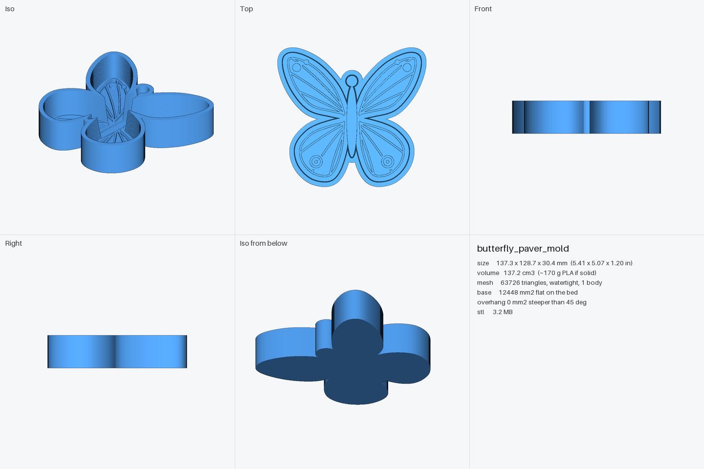

# 3D Workspace

Describe an object in plain words and get back a print-ready STL. Built for
[Claude Code](https://claude.com/claude-code): Claude writes each model as a short
Python script, builds it, checks it's printable, looks at the rendered previews, fixes
what's off, and hands you the STL. Nothing is modeled by hand. To tweak a result
yourself, import the STL into Tinkercad, a slicer, or any CAD app.

| | |
|---|---|
|  | Example: a 5 in cement paver mold with butterfly relief, built from the prompt *"a 5x5 inch cement paver mold in the shape of a 2D butterfly"*. |

## Quick start

Open Claude Code (terminal, desktop app, or IDE) in any folder and say:

> Set up this project: https://github.com/atsmith2k/3d-workspace

Claude clones it, installs everything, runs a self-test, and asks what you want to make.
Then just describe it:

> A wall hook for a 1/2 in dowel, holds 2 kg, screw holes for #8 screws
>
> A 5 in cement paver mold shaped like an oak leaf, with vein detail
>
> A cable organizer clip for three USB-C cables that sticks to a desk edge

---

## For Claude: setting up this project

Follow these steps when a user asks you to set up this repository.

1. **Clone it.** Ask the user where to put it only if they haven't said; otherwise clone
   into their usual projects folder (for example `~/git/3d-workspace` or
   `F:\git\3d-workspace`). If you are in the Claude desktop app, move the session into
   the cloned folder (`change_directory`) so this session and later ones load the
   repo's `CLAUDE.md`.
2. **Run setup** from the repo root and wait for the last line to say `READY`:
   - Windows: `py scripts/setup.py` (or `python scripts/setup.py`)
   - macOS / Linux: `python3 scripts/setup.py`

   It finds Python 3.12-3.14, creates `.venv`, installs pinned packages (about 150 MB,
   mostly the OpenCascade CAD kernel), and runs `cad selftest`, which builds a CAD part
   and the butterfly mold and checks both are watertight. It is safe to re-run.
   If it reports that no supported Python is installed, tell the user the exact install
   command it printed, and offer to run it.
3. **Read `CLAUDE.md`.** It holds the modeling workflow, the model-script contract, which
   CAD kernel to use when, 3D-printing design rules, and known pitfalls.
4. **Tell the user it's ready** in a few lines: what got installed, that the self-test
   passed, and where STLs will appear (`output/<model>/`). End with:

   > **Give me instructions for the model you want to make.** Describe the object, its
   > rough size, and whether it's printed directly or used as a mold (cement, plaster,
   > resin). Photos or sketches help too.

---

## How it works

```
you describe it  ->  models/<name>.py  ->  cad build  ->  output/<name>/
                     (Claude writes)       (checks it)    <name>.stl          print or import into Tinkercad
                                                          <name>.step         editable CAD (engineered parts)
                                                          <name>_preview.png  7 views incl. dimensions + sections, stats, warnings
                                                          <name>_a1.3mf       sliced Bambu Studio project (cad slice), open and print
                                                          build.json, slice.json, report.txt
                                                          manifest.json, _product.png, _print_notes.txt   (cad publish)
```

Built for Bambu Lab printers: the A1 is the default and `--printer a1mini` targets the
A1 mini. `cad slice` drives Bambu Studio's own CLI with its system presets, so the print
time and filament match what the slicer shows, and the 3MF it writes is ready to print.
PrusaSlicer is used as a fallback when Bambu Studio is not installed.

`cad build` checks every model before you see it: watertight single solid, flat base,
overhangs that would need support (red in the preview), walls thinner than 1.2 mm
(yellow), fits the print bed, under Tinkercad's 25 MB limit. Each model also declares
its own acceptance checks (overall size, hole diameters, material where it should be,
floor thickness...) written from the request, and the build fails if any of them fails. `cad slice` runs
Bambu Studio headlessly for the print time, filament use and whether supports are needed.

Two modeling engines, picked per object:

- **build123d** (OpenCascade): engineered parts with fillets, holes, exact fits; also exports STEP.
  Threads, fasteners, bearings and gears come from bd_warehouse; a hardware table supplies
  insert, screw, magnet, port and board dimensions so nothing is guessed.
- **manifold3d**: decorative and organic work: reliefs, molds with artwork, patterns, text.
- **SDF** (implicit modeling): smooth blends, gyroid lattice infill, shells, twists.

Images come in too: a logo or sketch is traced into an outline, an SVG is loaded directly,
and a photo becomes a relief or lithophane. Multi-part models declare how they assemble
and the build measures interference and clearance between the parts.

## Commands

Run from the repo root. Windows: `cad ...`; macOS/Linux/Git Bash: `./cad ...`

| Command | Does |
|---|---|
| `cad build models/<name>.py` | Build, check, export STL (+STEP), render preview |
| `cad build models/<name>.py --set thickness=30` | Build a variant with a parameter changed |
| `cad build ... --fast` | Quicker, coarser build for iterating |
| `cad build ... --printer a1mini` | Target the A1 mini (180 mm bed) instead of the A1; `--bed X Y Z` for anything else |
| `cad build ... --section y=10` | Cut the section views at a chosen place (default: centre) |
| `cad slice models/<name>.py [--printer a1mini] [--supports] [--layer-height 0.28] [--filament "Bambu PETG Basic"]` | Slice with Bambu Studio: print time, filament, layers, and a ready-to-print 3MF (`--slice` on build does the same) |
| `cad measure models/<name>.py --probe 10,5,2 --hole 10,5` | Is a point inside? how thick there? hole diameter? |
| `cad build ... --sweep thickness=2,3,4` | Build every value and write one comparison sheet |
| `cad trace logo.png --width 60` | Trace an image to an SVG outline (plus a preview) for use in a model |
| `cad litho new photo.jpg --width 100 --shape arc` | Photo to lithophane model (flat, arc or cylinder lamp shade; oval, heart, hexagon outlines), built with a simulated backlit view |
| `cad litho calibrate wedge.jpg` | Measure your filament's light transmittance from a photo of `models/lithophane_calibration.py` |
| `cad lint models/<name>.py` | Static checks for known pitfalls |
| `cad publish models/<name>.py [--refresh] [--printers a1,a1mini]` | Shop-ready folder: full build, a 3MF per printer, clean product renders, print notes and `manifest.json` (`--refresh` rebuilds and re-slices) |
| `cad selftest [--update]` | Regression suite over `tests/expected.json` (`--update` re-records) |
| `cad new <name> "description"` | Start a model from the template |
| `cad list` | List models and whether they're built |
| `cad stitch build designs/<name>.py [--engine inkstitch\|native] [--hoop 5x7]` | Embroidery: Ink/Stitch SVG + PES/DST/JEF/EXP/VP3/XXX, checks, preview (see below) |
| `cad stitch inspect file.pes` | Stats, density map and preview of any stitch file |
| `cad stitch publish designs/<name>.py` | Embroidery product: every size, 8 formats, realistic product shot and mockups, thread chart, notes, zip, manifest |
| `cad stitch bundle <collection>` | Bundle product (cover, contents, zip of zips) from a collection's published designs |
| `cad stitch sim file.pes` (or `designs/<name>.py`) | Watch it sew in the stitchsim viewer ([tools/stitchsim](tools/stitchsim/README.md), Rust; built with cargo on first use) |
| `cad stitch new <name> "description"` / `cad stitch list` | Start a design / list designs and Ink/Stitch status |

## Embroidery designs

The same generative loop works for machine embroidery. Describe the design; Claude writes
`designs/<name>.py` (fills, satin columns and running stitches built from shapes, text,
SVGs or traced images), and `cad stitch build` writes `output/embroidery/<name>/`:

- `<name>.svg`: Ink/Stitch-ready artwork, one path per element in sewing order with its
  stitch parameters as `inkstitch:*` attributes. Open it in Inkscape to see or tweak
  exactly what was asked for (Extensions > Ink/Stitch > Params), and re-export from there.
- `<name>.pes` (PES v6, exact thread colours), `.dst`, `.jef`, `.exp`, `.vp3`, `.xxx`
- `<name>_preview.png`: thread render on fabric with the hoop, a 24 mm detail at thread
  scale (densest spot, or `--detail x,y`), sewing order with jump threads, a thread-layer
  density map, the thread list with the nearest Brother colours
- `build.json`, `report.txt`: size, stitch count, colours, trims, jumps, thread length,
  sew time, density, stitch lengths, coverage (largest bare patch) and every check

Stitches come from [Ink/Stitch](https://inkstitch.org) run headlessly on the SVG when it is
installed (found in the Inkscape extensions folder, or set `CAD_INKSTITCH`), so the files
match what Ink/Stitch itself would save; otherwise a built-in engine is used. Both read
back through the same checks.

## Editing a result in Tinkercad

Tinkercad > **Import** > choose the `.stl` > units **mm**. It arrives as one shape you can
resize, group, or combine with holes. Better still, ask Claude for the change and keep
the model script as the source of truth.

## Requirements

Python 3.12, 3.13 or 3.14 on Windows, macOS or Linux. Setup installs the rest into `.venv`.
`cad slice` is optional and needs [Bambu Studio](https://bambulab.com/en/download/studio)
installed (or PrusaSlicer as a fallback); both are found automatically in their default
locations, or set `CAD_BAMBU` / `CAD_SLICER` to the binary.
`cad stitch` works without extra software; with Inkscape + Ink/Stitch (3.x) installed it
uses Ink/Stitch's stitch engine.
